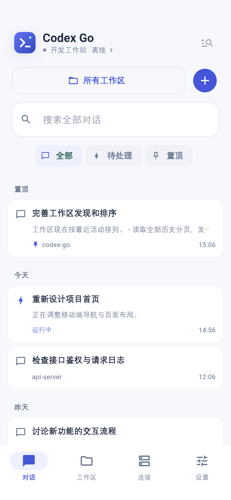
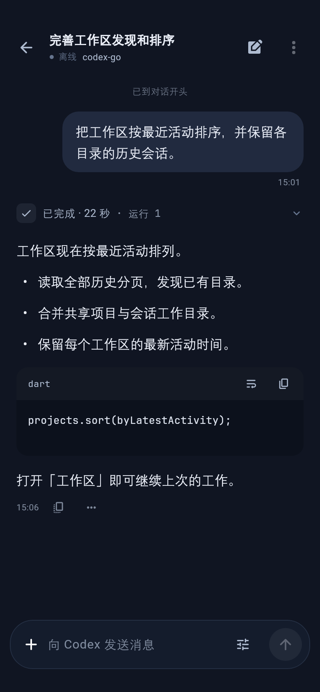

# Codex Go

[简体中文](README.md) · [Contributing](CONTRIBUTING.md) · [Security](SECURITY.md) · [MIT License](LICENSE)

Continue work on your own development machine from an Android phone. Codex Go connects over SSH using Codex's native app-server protocol, so your code, tools, and task execution stay on the remote machine.

**Version 0.1.0 is a preview.** This is an independently maintained project, not an official OpenAI application and not endorsed by OpenAI. The current target is Android ARM64; remote connections have been verified on Linux.

<p>
  
  
</p>

Screenshots use sample data rendered by the real application. The app supports English and Simplified Chinese.

## Features

- Resume, search, pin, archive, and restore conversations.
- Discover workspaces from shared projects and conversation history, ordered by recent activity.
- Read streaming replies, message timestamps, collapsible work logs, file changes, and diffs. Code blocks support highlighting, copying, and wrapping.
- Choose models, reasoning effort, and permissions; interrupt, steer, or queue messages; answer questions and approval requests.
- Upload attachments, preview images and videos, download files, and forward development ports over SSH.
- Keep drafts and an outgoing queue, reconnect after interruptions, and switch between light and dark themes.

## Get started

1. Make your development machine reachable over SSH. Install Codex using the [official CLI documentation](https://developers.openai.com/codex/cli), and sign in on that machine first.
2. Check protocol capabilities. The current development baseline is **Codex CLI 0.167.1**, not a claimed minimum version:

   ```sh
   codex --version
   codex app-server --help
   codex app-server proxy --help
   codex app-server daemon --help
   ```

   The client needs Unix socket transport and `app-server proxy`. Shared mode also needs `daemon start` or an existing shared service. If these capabilities are absent, use a Codex version that provides them. See the [app-server documentation](https://developers.openai.com/codex/app-server). Compatibility with every past or future protocol version is not guaranteed.
3. Install the `arm64-v8a-release.apk` from this repository's Releases page. Android 7.0 / API 24 or later is required.
4. Add an SSH host in **Connections**, using a password or private key. Jump hosts and SSH configuration import are available. Verify the fingerprint before accepting the first connection.
5. Keep **Shared service**, the default, unless you have a specific reason to change it. Open a workspace or an existing conversation and continue working.

| Service mode | Purpose | Socket configuration |
| --- | --- | --- |
| Shared, default | Start or reuse Codex's managed service | Automatic |
| Independent | Start a separate app-server process for Codex Go | Automatic |
| Custom socket | Connect to an app-server you manage | Remote absolute path required |

You normally do not need to enter a socket path or expose an app-server port publicly. All modes use SSH. An independent process still uses the remote user's Codex identity and data; it does not provide account or workspace isolation.

## Build from source

[tool/flutter-sdk.json](tool/flutter-sdk.json) pins Flutter **3.47.7** and its source revision. It includes Dart 3.13.5; use **JDK 17**, a configured Android SDK, and accepted Android SDK licenses. Check the Android toolchain with `flutter doctor -v`. The helper scripts require Bash.

From the project directory:

```sh
flutter pub get --enforce-lockfile
bash tool/check.sh
bash tool/build_android.sh --no-pub
```

The default output is an optimized development preview signed with a debug key:

```text
build/artifacts/codex-go-0.1.0-arm64-v8a-preview.apk
build/artifacts/codex-go-0.1.0-arm64-v8a-preview.apk.sha256
```

Use `--debug` for a debug build or `--signed` for a release signed with your own key. The dependency lockfile is committed. SDKs and caches are not; standard `PUB_CACHE` and `GRADLE_USER_HOME` variables can reuse existing caches.

The Android application ID is `dev.codexgo.app`. It installs separately from Android-SSH-Codex and does not migrate that app's saved credentials.

## Limitations and troubleshooting

- If SSH connects but the app-server or tunnel fails, check Codex authentication and the commands above. The client resolves Codex outside an interactive shell; custom installations can supply environment variables in host settings. Distinguish SSH failures from service startup and socket proxy failures.
- Workspace discovery uses shared project records and conversation working directories. It does not enumerate every folder on disk. Create a workspace or conversation for a directory with no existing records.
- Historical message timestamps appear only when the server recorded them; refresh times are never substituted.
- Android battery policies can terminate background connections. Reconnection is supported, but uninterrupted operation on every device is not guaranteed.
- iOS, desktop clients, other CPU architectures, and other remote operating systems are outside the verified scope.

## Contributing and attribution

See [CONTRIBUTING.md](CONTRIBUTING.md) for development conventions and validation. Use the Issue templates for bugs and feature requests, and [SECURITY.md](SECURITY.md) for sensitive reports.

The project uses the [MIT License](LICENSE). SSH transport, Codex protocol handling, conversation merging, attachments, parts of conversation presentation, and Android background/preview support were adapted from [Android-SSH-Codex](https://github.com/wkj2333666/Android-SSH-Codex), based on revision `41f1f144e2049da78d471199aa3516bc4f333e59` and verified local improvements. Original copyright and license notices are retained in [LICENSE](LICENSE) and [the bundled notice](assets/licenses/android-ssh-codex.txt).

Codex Go independently organizes navigation, runtime responsibilities, workspaces, host management, conversation interaction, and builds. Its conversation interaction also draws on dsh-Go's product design; it has no runtime or build dependency on dsh-Go's directories or services.

JetBrains Mono is distributed under [SIL OFL 1.1](assets/licenses/jetbrains-mono.txt). Syntax highlighting uses re_highlight. Dependency notices are available through the app's open-source licenses page.

The Gradle Wrapper comes from the official Gradle distribution under Apache License 2.0. Its full license is retained in `META-INF/LICENSE` inside `android/gradle/wrapper/gradle-wrapper.jar`.
