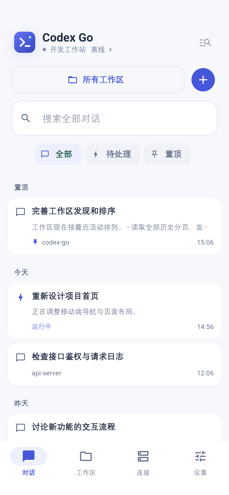
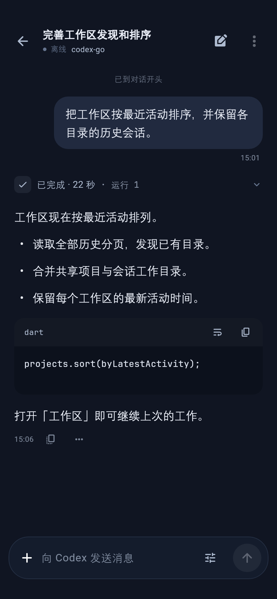

# Codex Go

[English](README.en.md) · [参与开发](CONTRIBUTING.md) · [安全说明](SECURITY.md) · [MIT License](LICENSE)

在 Android 手机上连接自己的开发电脑，继续 Codex 对话、查看代码改动、处理权限确认。通过 SSH 使用远端 Codex 的原生 app-server 协议，代码、工具和任务执行留在你的电脑上。

**当前为 0.1.0 预览版。** 本项目独立维护，非 OpenAI 官方应用，也未获 OpenAI 背书。目前面向 Android ARM64 手机；远端已在 Linux 环境验证，其他平台尚未验证。

<p>
  
  
</p>

截图来自真实界面的示例数据，不含个人主机或真实对话。

## 它能做什么

- **接着工作**：浏览、搜索和继续已有会话，置顶、归档与恢复会话。
- **按项目组织**：结合共享项目和完整会话历史发现工作区，按最近活动排序。
- **读懂执行过程**：流式回复、分钟级消息时间、可展开的动作记录、文件改动与 diff；代码支持高亮、复制和换行。
- **控制下一步**：选择模型、推理强度与权限；停止生成、插话、排队发送，回答 Codex 提问和权限请求。
- **传递上下文**：上传附件，上传图片前可裁剪、画笔标注、撤销或选择原图；支持图片和视频预览、远端文件下载，以及通过 SSH 转发端口查看开发服务。
- **适应手机使用**：保存草稿与发送队列，支持重连和后台连接保持，提供简体中文 / English、明亮 / 深色外观。

## 开始使用

### 1. 准备远端电脑

- 手机能够通过 SSH 访问这台电脑，且你拥有对应账号与凭据。
- 按 [Codex CLI 官方文档](https://developers.openai.com/codex/cli)安装 Codex，并先在远端终端完成登录。
- 当前开发环境使用 **Codex CLI 0.167.1**。这是验证基线，不代表最低兼容版本。

本客户端依赖 app-server 的 Unix socket 和 `proxy` 子命令；默认共享模式还需要 `daemon start`，或已经运行的共享服务。可以在远端先检查：

```sh
codex --version
codex app-server --help
codex app-server proxy --help
codex app-server daemon --help
```

若缺少对应子命令或 `unix://` 监听方式，请先升级到具有这些能力的 Codex 版本。官方协议说明见 [Codex app-server](https://developers.openai.com/codex/app-server)。协议仍在演进，暂不承诺兼容所有新旧版本。

### 2. 安装 Android 客户端

正式发布的安装包放在仓库的 **Releases** 页面，选择 `arm64-v8a-release.apk`。支持 Android 7.0（API 24）及以上。

GitHub Actions 产物中的 `preview.apk` 用于开发验收，使用调试签名；它与正式发布密钥签名的安装包不能相互覆盖更新。需要自行构建时，见下方说明。

### 3. 添加连接并开始对话

1. 打开「连接」，填写 SSH 地址、端口和用户名，选择密码或私钥认证。需要时可配置跳板机，或导入 SSH 配置。
2. 首次连接时核对主机指纹，再确认连接。
3. 服务模式保持默认的「共享服务」即可，通常**不需要填写 socket 路径**。
4. 在「工作区」选择目录，或从「对话」打开已有任务；新建对话后发送第一条消息。

| 服务模式 | 适用情况 | 是否需要填写 socket |
| --- | --- | --- |
| 共享服务（默认） | 启动或复用远端 Codex 管理的共享服务 | 不需要，自动获取 |
| 独立服务 | 为 Codex Go 启动单独的 app-server 进程 | 不需要，自动管理 |
| 指定 socket | 连接你自己管理的现有 app-server | 需要填写远端绝对路径 |

三种模式均通过 SSH 访问远端，不需要把 app-server 端口暴露到公网。独立服务指单独的服务进程；它仍使用同一远端用户的 Codex 账号和数据目录，不等同于账号或工作区隔离。

## 从源码构建

工具链版本固定在 [tool/flutter-sdk.json](tool/flutter-sdk.json)：Flutter **3.47.7**（包含 Dart 3.13.5）、JDK **17**。安装 Android SDK、接受 SDK 许可，并确保 `flutter doctor -v` 中 Android 工具链可用。脚本需要 Bash；Windows 开发者可使用合适的 Bash 环境。

进入源码目录后执行：

```sh
flutter pub get --enforce-lockfile
bash tool/check.sh
bash tool/build_android.sh --no-pub
```

默认生成优化过的开发预览包和校验文件：

```text
build/artifacts/codex-go-0.1.0-arm64-v8a-preview.apk
build/artifacts/codex-go-0.1.0-arm64-v8a-preview.apk.sha256
```

`--debug` 生成调试构建；`--signed` 生成正式签名构建。依赖锁文件提交到仓库；工具链和依赖缓存不提交，可通过标准 `PUB_CACHE`、`GRADLE_USER_HOME` 环境变量复用。

应用 ID 为 `dev.codexgo.app`。它与 Android-SSH-Codex 独立安装、独立存储，不自动迁移旧应用凭据。

## 常见问题与限制

- **SSH 已连上，但服务或隧道失败**：先核对远端 Codex 登录状态及上述子命令；客户端会尝试解析非交互 SSH 环境的 PATH。自定义安装可在主机配置中补充环境变量。查看错误阶段时，要区分 SSH、远端服务启动和 socket 代理。
- **没有出现预期工作区**：工作区来自共享项目记录和会话工作目录；它不是扫描磁盘上的每个文件夹。没有任何记录的目录需要手动新建工作区或会话。
- **历史消息没有时间**：只显示服务端实际记录的时间，不用刷新时间补造历史时间。
- **后台连接被系统终止**：Android 的省电策略可能限制后台服务；客户端提供重连，但无法保证任意设备上永不断线。
- **平台支持**：当前发布目标为 Android ARM64；iOS、桌面客户端、其他 CPU 架构与其他远端系统不在已验证范围内。

## 参与开发

请先阅读 [CONTRIBUTING.md](CONTRIBUTING.md)。Bug 和功能建议可使用仓库的 Issue 模板；涉及凭据或安全漏洞时，请先阅读 [SECURITY.md](SECURITY.md)。

```text
lib/app/             应用入口、生命周期与主题
lib/domain/          会话、工作区、草稿与状态模型
lib/infrastructure/  SSH、Codex RPC、安全存储与平台接口
lib/runtime/         连接、目录、消息队列与会话操作
lib/features/        对话、工作区、连接与设置界面
lib/shared/          通用组件、格式化与媒体能力
lib/l10n/            中英文文案
android/             Android 原生能力
```

## 来源与许可

本项目采用 [MIT License](LICENSE)。

SSH 传输、Codex 协议、会话归并、附件和部分对话呈现，以及 Android 后台连接与预览能力，基于 [Android-SSH-Codex](https://github.com/wkj2333666/Android-SSH-Codex) 改编。参考基线为 `41f1f144e2049da78d471199aa3516bc4f333e59`，并吸收了本地版本已验证的修复；原作者版权与许可保留在 [LICENSE](LICENSE) 和 [资源许可](assets/licenses/android-ssh-codex.txt) 中。

Codex Go 独立组织应用导航、运行时职责、工作区、连接管理、对话体验和构建工程。对话交互参考了 dsh-Go 的产品实践，项目运行与构建不依赖 dsh-Go 的目录或服务。

代码字体使用 JetBrains Mono，遵循 [SIL OFL 1.1](assets/licenses/jetbrains-mono.txt)；语法高亮使用 re_highlight。其他依赖的许可可在应用的开源许可页面查看。

Gradle Wrapper 来自 Gradle 官方发行版本，遵循 Apache License 2.0；完整许可保留在 `android/gradle/wrapper/gradle-wrapper.jar` 的 `META-INF/LICENSE` 中。
